# AI全域运营系统 Mermaid 结构图

403：取消独立运营台；目标可改并调用本机Codex重排；七类策略/三档具体费用与经营全景、商品、推广、用户看板。见[变更与契约](changes/2026-10-27-commerce-planning-dashboard.md)。

401：GMV情景→渠道分工/支撑指标→具体资源/排期/动作→商品项目，主图/详情/视频分面通过品牌任务调用本机Codex并保存版本。无效/跨品牌深链阻止误选，复制委托仅备用。见[经营分工与Codex](changes/2026-10-26-commerce-gmv-executor.md)。
400：电商财务目标→驱动指标→行动资源排期→完整窗口数据跟踪及未达标建议，兼容旧报告安全排版/历史；第三方采集仍须授权连接器回写。见[财务目标与跟踪](changes/2026-10-26-commerce-financial-scorecard.md)。

399纠正：电商三层按整页切换，旧方案report/actions直接可见，六类数据仅总览，方案/报表选择分开；不以新增字段或选中态代替业务内容验收。见[电商兼容修复](changes/2026-10-26-commerce-view-compatibility.md)。


398：电商既有两入口补主图/商品文案与品牌生意→战略/策略/执行→同口径结果对照；旧数据/版本和23技能架构保持。见[电商增长链路](changes/2026-10-26-commerce-growth-loop.md)。


391：Acquisition一级显示名更新，子节点与路由不变。见[公域菜单改名](changes/2026-10-26-public-acquisition-label.md)。

389三层与图表关系（参考[三层经营与图表改版](changes/2026-10-26-private-strategy-analytics.md)）：

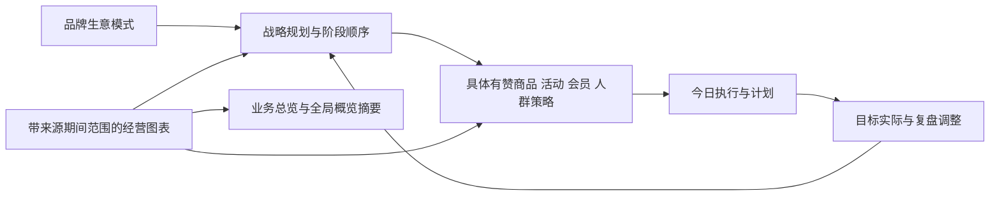

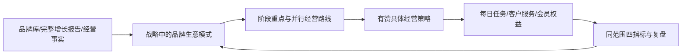

387：私域从品牌生意模式承接，新增businessModel/经营路线与策略关联（契约1.5.0）；先看经营依据与本周行动，再看策略/逐日安排。技能4.0源21文件、三副本63文件/下载包一致；具体经营、状态与来源分层，旧数据和其他板块兼容保留。见[生意模式与私域承接](changes/2026-10-26-business-model-private-operations.md)。

385：私域去掉投流目标，战略默认前置，按阶段顺序→具体商品活动单→按日动作→四指标/实际组织；新增stagePlan/activityPlan，旧数据与其他投流模块兼容保留。技能3.3强制具体参数、来源推导及结构校验，安装/代码/原生业务/实际增长分别验收。见[阶段与活动单](changes/2026-10-26-private-stage-and-activity.md)。

384：私域默认“今日经营”，按进店/转化/客单/复购/投流→行动→负责人/时间→执行→目标实际组织；老板可按指标进入原计划和任务。来源未知不造达标，日数据不拿历史累计替代，AI按钮为复制委托。见[老板经营台与契约](changes/2026-10-26-private-owner-cockpit.md)。

[此段涉及具体客户资料，公开版本已省略。]

[此段涉及具体客户资料，公开版本已省略。]

[此段涉及具体客户资料，公开版本已省略。]


378私域运营，见[契约](private-operations-workspace.md)：

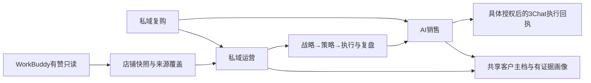

376私域新增，参考[AI销售契约](ai-sales-workspace.md)：

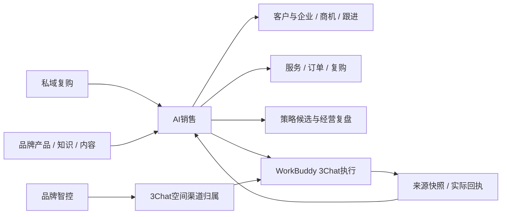


375归档关系（既有菜单内）：

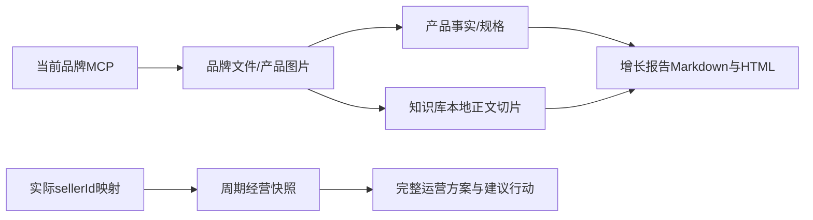

见[归档说明](brand-document-import.md)。


374导航关系，旧业务路由保留；参考[电商变更](changes/2026-10-25-commerce-workspaces.md)。

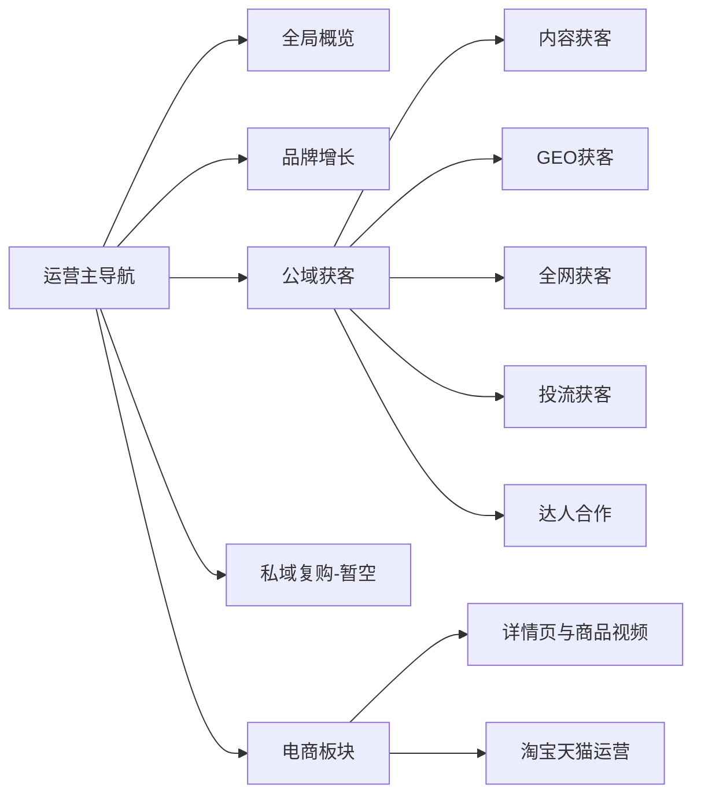


370：新增自用seedance2.0 Mini多参（2089757422163419137），保留原24项，现25项；20实时字段、页面/MCP/下载包及旧目录通过，只Lab server更新。见[多参应用接入](changes/2026-10-25-runninghub-mini-multi-reference.md)。

369：新增Seedance Mini图生视频，RunningHub共24应用；参数请求超时/旧响应保护及字段类型、真实数值枚举修正。24项只读参数接口87—206ms全部成功；历史长等待与生成未知分开。见[接入与性能检查](changes/2026-10-25-runninghub-seedance-mini-performance.md)。

368：RunningHub目录独立加载，作品列表先返回保存快照；状态查询及历史归档按品牌单飞后台补偿，查询有超时，旧品牌延迟结果不落入当前页面。入口/权限/生成参数不变。见[加载阻塞修复](changes/2026-10-25-runninghub-workspace-loading.md)。

354按用户纠正撤掉353制作分项/短期限/撤销历史界面；完整品牌运营连接默认包含图片、语音、RunningHub，原令牌直接读204工具。旧JSON/历史保留兼容，品牌隔离和连接生命周期不变。69策略、9API、29模块/42写回、182页面、6行为/8布局、26运行hash通过；仍有五顶部委托未接、五导出404，真实供应商/独立专家待验。见[制作直接使用及复查](changes/2026-10-22-production-direct-use-and-functional-recheck.md)。

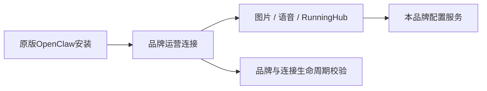

会话353：原OpenClaw安装区新增单连接图片/语音/RunningHub制作授权、期限/撤销/历史；旧14/24/203不自动扩权。MCP列表与调用精确控动作、轮换保留授权，蝉镜并发刷新和失败提示完善。55策略、15API/MCP、7页面/4宽及26运行hash通过；无真实生成/供应商调用。见[制作授权变更](changes/2026-10-22-brand-production-authorization.md)。

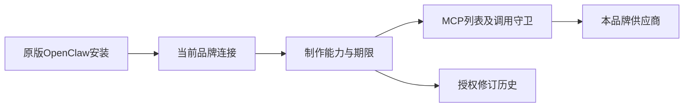

351关系补充：旧业务入口→对应运营/tabs；旧OpenClaw/接口→本品牌配置；任务→个人任务中心→当前品牌数据。平台权限边界不变。见[变更](changes/2026-10-22-all-brand-system-audit.md)。

会话350恢复品牌MCP业务范围：完整目录244中明确203项品牌运营工具，41项发布/付费生成/人工审阅及平台个人配置不自动开放；manage_*子动作同策略限制。旧read14/work24不静默扩展，品牌Owner/Admin可单连接确认升级，保留令牌/MCP名称/配置并追加授权修订；页面显示真实数量和连接选择。指定用户连接已14→203并用原环境引用令牌真实HTTP回验，未执行模型或发布。见[品牌运营授权](changes/2026-10-22-brand-operations-grant.md)。

会话348：品牌第三方接口凭据保存增加提交处持久反馈、可关闭浮动提醒与保存中状态；按当前平台显示，编辑清旧提示，成功后清空输入。PATCH成功与列表刷新失败分别提示，保存成功不等于供应商连通。仅页面反馈，不改凭据/授权/模型调用。见[保存反馈](changes/2026-10-22-brand-api-key-save-feedback.md)。

会话347更正346的安装区实现：直接提取原OpenClaw安装区为共享组件，平台与品牌后台渲染同一界面；保留正式令牌查看/隐藏、6类客户端片段、Git/ZIP和原指南。安装页移除高级设置；模型/Skill/知识版本数据与独立历史页保留，不是安装步骤。品牌适配只操作当前连接，新连接30天work范围在确认中明确，旧连接不扩权、不全品牌重置；原连接/其他品牌不受影响。Codex仍为环境变量引用，实际安全绑定和客户端执行尚未接通。见[原版安装区复用](changes/2026-10-22-original-openclaw-shared-installation.md)。

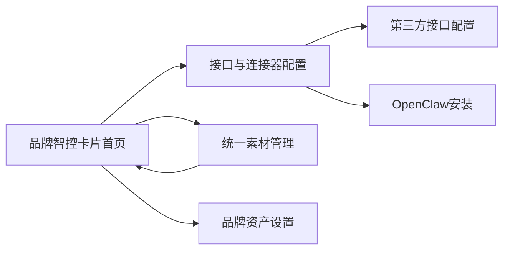

会话346按用户确认恢复品牌智控原版操作：卡片式首页；接口与连接器配置内“第三方接口配置 / OpenClaw 安装”双Tab，版本组合放高级设置；知识/成员/品牌技能移出主导航，旧数据与业务页保留。品牌素材位于/brand-admin/assets，原共享素材入口按当前权限返回，平台管理边界不放宽。见[使用回归修复](changes/2026-10-22-brand-control-familiar-workflow.md)。

品牌独立模型与执行配置：用户选择BYOK；`/brand-admin/models`设置本品牌服务凭据，`/brand-admin/execution`保存/发布/回退版本，`/brand-admin/knowledge`复用品牌知识入口。新增凭据密文列、列表不回显Key、空保存保留/显式清除留空墓碑防旧值复活。只读MCP返回冻结组合；实际客户端授权/加载与专家执行未完成。见[变更](changes/2026-10-21-brand-models-and-execution-profile.md)。

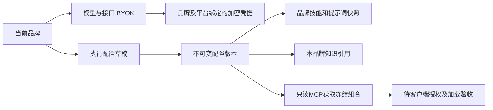

[此段涉及具体客户资料，公开版本已省略。]

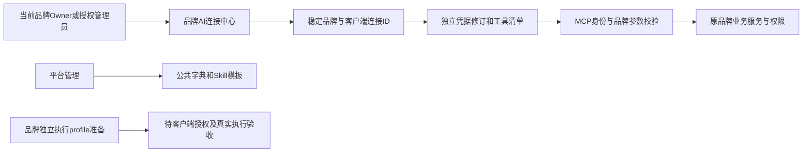


品牌主账号后台规则：注册即本品牌OWNER/完整品牌权限，进入独立品牌智控后台；平台全局管理另行授权。品牌设置/团队与权限/品牌Skill/素材复用既有API，加入他牌协作不隐藏原OWNER品牌。见[会话341变更](changes/2026-10-21-brand-owner-admin-workspace.md)。

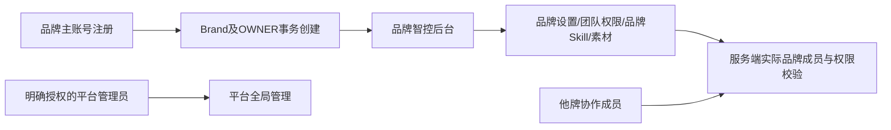

[此段涉及具体客户资料，公开版本已省略。]


多账号并行：真实登录/邀请码注册、标签页独立会话、账号与品牌入口、标准Lab严格权限及当前品牌读写；共享演示数据不再充当经营事实。已通过双账号/越权/过期测试，新品牌WorkBuddy授权仍需接入。详见[会话338变更](changes/2026-10-21-multi-account-brand-isolation.md)。

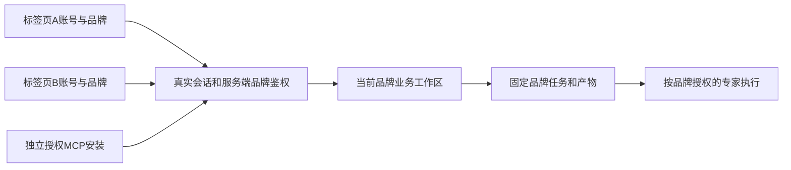


本机WorkBuddy增长执行器：受控后台启动、当前品牌/计划MCP代理、真实成员与提交回执、90秒心跳；不自动生效/采纳/发布/支出。详见[会话336变更](changes/2026-10-21-workbuddy-growth-executor.md)。实际联调结论见该文档与总控收尾记录。


经营驾驶舱与持续增长计划：六时间/六业务真实统计，结构化计划/检查/建议/不可变版本、来源上报与独立Lab只读调度，12项同源MCP；专业执行采用WorkBuddy拉取队列，未实现反向唤起。详见[会话335变更](changes/2026-10-21-growth-cockpit-and-plans.md)。


作品拆解追加：WorkBuddy授权范围内自动挑选（候选去重）、采集作品页码跳转、取消后列表移除并终止提交。详见[会话332变更](changes/2026-10-21-work-analysis-selection-pagination-cancel.md)。


## 三平台作品拆解

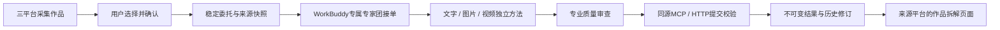

当前网页不反向启动WorkBuddy，委托等待客户端接单。详见[变更记录](changes/2026-10-21-content-work-analysis.md)。

## lab 运行隔离入口（基础部署已验收）

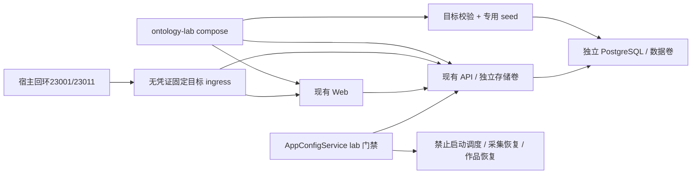

应用/DB/db-init只加入lab internal网络；ingress另接独立入口bridge并发布宿主回环23001/23011，无业务凭证/数据卷、禁IP转发，不提供任意目标代理。参考：[lab运行基线](ontology-lab-runtime.md)、[第一批保护](changes/2026-09-26-ontology-lab-isolation.md)。

专用 Dockerfile 共用依赖阶段、分别构建 server/web；源码外准备凭证，宿主验收脚本检查真实 API/DB/网络。lab 鉴权在品牌选择前拒绝不可访问的明确目标。实测进度见 [部署验收](changes/2026-09-26-ontology-lab-runtime-verification.md)。

## 1. 文档定位

本文件是 `docs/site-map.md` 的可视化补充，只保留当前系统真实在用的结构关系。

## 2. 全站总图

```mermaid
flowchart TD
    A["AI全域运营系统"]

    A --> B["apps/web 前端站点"]
    A --> C["apps/server 后端 API"]
    A --> D["packages/* 共享能力"]
    A --> E["docs 当前文档体系"]
    A --> F["local-single-user 交付链"]

    B --> B1["官网首页 /"]
    B --> B2["认证页 /login /register /admin/login"]
    B --> B3["品牌增长 /brand-growth"]
    B --> B4["内容获客 /xiaohongshu"]
    B --> B5["抖音兼容直达 /douyin"]
    B --> B6["公众号兼容直达 /wechat"]
    B --> B7["GEO获客 /geo"]
    B --> B8["全网获客 /all-network-growth"]
    B --> B9["投流获客 /paid-acquisition"]
    B --> B9A["达人合作 /creator-cooperation"]
    B --> B10["设计工作台 /more-features/design"]
    B --> B11["个人中心 /personal-center"]
    B --> B12["后台 /admin"]
    B --> B13["帮助页 /help/*"]
    B --> B14["AI 智控后台 /ai-control\nOntology编排 / 专家/Skill真源 / 任务治理 / 接口证据 / 素材归档"]

    C --> C1["Auth"]
    C --> C2["Brands"]
    C --> C3["Collectors"]
    C --> C4["Reports"]
    C --> C5["Works"]
    C --> C6["Tasks"]
    C --> C7["Publishing"]
    C --> C8["Media"]
    C --> C9["Orders"]
    C --> C10["ThirdPartyPlatforms"]
    C --> C11["UserSkills"]
    C --> C12["AI 智控中心"]
    C --> C13["Feedback"]
    C --> C14["Scheduler"]
    C --> C15["Admin 模块组"]
    C12 --> C121["/api/ai-control/tree\n读取 /expert-source"]
    C12 --> C122["/api/ai-control/read\n回读真实 Markdown"]
    C12 --> C123["专家/Skill 编辑 Tab\n字段草稿 + 本地 Diff"]
    C12 --> C123A["/api/ai-control/local-history\n本机快照历史 / 快照恢复预览"]
    C12 --> C124["/api/ai-control/expert-source/mount-guide\n目录挂载向导"]
    C12 --> C132["/api/ai-control/ontology/elements\n真实元素库只读聚合"]
    C12 --> C133["/api/ai-control/ontology/flows/*\n草稿流程 / 节点编辑 / 连线规则 / 确认闸 / 预览 / 发布契约"]
    C133 --> C141["POST /api/ai-control/ontology/flows/:flowId/structure-scan\n按节点绑定 expert-source 只读扫描"]
    C133 --> C142["GET /api/ai-control/ontology/flows/:flowId/structure-changes\n读取节点级结构变化摘要"]
    C141 --> C123A
    C142 --> C123A
    C133 --> C134["/api/ai-control/ontology/execution-plan\n从 published_contract 派生执行前计划"]
    C134 --> C135["/api/ai-control/ontology/execution-plan/evidence\n写入 wf_execution_events 执行前证据"]
    C134 --> C136["/api/ai-control/ontology/execution-node/evidence\n写入节点受控推进证据"]
    C133 --> C137["REST + MCP 专家源 Diff 预览\npublished_contract -> 真实 WorkBuddy 专家文件候选 Diff"]
    C137 --> C138["REST + MCP 写回确认闸\nDiff SHA / 候选 SHA / 快照 / 可写挂载 / 用户授权"]
    C138 --> C139["专家源启动前读取规则\npublished_contract + execution plan + preflight/node evidence"]
    C139 --> C140["受控真实写回执行器\n默认 blocked_before_write / 全闸通过才原子写盘"]
    C12 --> C126["/api/ai-control/assets/archive\n素材/作品/任务产物只读索引"]
    C12 --> C127["/api/ai-control/assets/archive-registration\n已有素材/作品归档登记"]
    C127 --> C128["confirmNoGeneration=true\n不触发第三方生成"]
    C127 --> C129["可选 taskId -> wf_artifacts"]
    C127 --> C130["preflight\n标题/内容/资源证据/任务关联只读预检"]
    C127 --> C131["用户上传/用户文件夹\n统一素材接入"]
    C124 --> C125["apply-expert-source-mount-request.ps1\n应用只读挂载配置"]

    D --> D1["packages/config"]
    D --> D2["packages/prompt-runtime"]
    D --> D3["packages/shared"]
    D --> D4["packages/ui"]

    E --> E1["site-map.md"]
    E --> E2["site-map-mermaid.md"]
    E --> E3["engineering-standards.md"]
    E --> E4["changes/*.md"]
    E --> E5["project_planning/ 历史草案"]

    F --> F1["runtime env"]
    F --> F2["schema.local.prisma generate"]
    F --> F3["sqlite db init"]
    F --> F4["launcher"]
    F4 --> F47["健康实例复用 + 启动锁"]
    F --> F5["Windows autostart helper"]
    F --> F6["release bundle builder"]
    F --> F7["release package builder"]
    F --> F8["independent updater"]
    F4 --> F41["server build"]
    F4 --> F42["web standalone build"]
    F4 --> F43["runtime-isolated web bundle staging"]
    F43 --> F431["static/public sync in runtime bundle"]
    F4 --> F44["runtime metadata"]
    F4 --> F45["api + worker + web 进程拆分"]
    F45 --> F46["worker 独占后台守护/重任务提交"]
    F5 --> F51["install/remove/status scheduled task"]
    F6 --> F61[".release/local-single-user-win-x64"]
    F6 --> F62["bundled node.exe + npm + start/install cmd"]
    F7 --> F71["AiOmniOps-local-single-user-win-x64.zip"]
    F7 --> F72["zip sha256 checksum"]
```

## 3. 前端路由图

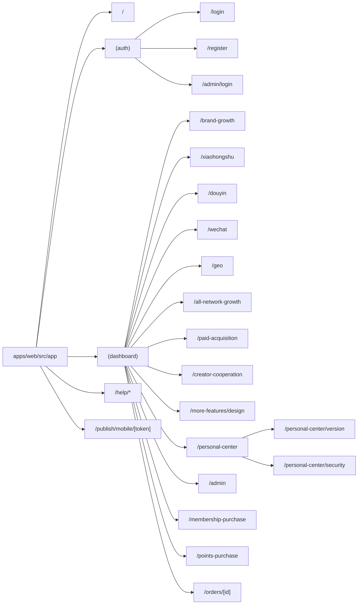

## 4. 业务工作台关系图

```mermaid
flowchart TD
    A["品牌增长策略"]
    B["内容获客工作台"]
    C["抖音工作台兼容直达"]
    D["公众号工作台兼容直达"]
    E["GEO获客工作台"]
    F["全网获客工作台"]
    G["设计工作台"]
    H["个人中心"]
    H --> H1["版本与升级（local-single-user 自动升级 / standard 更新引导）"]
    H --> H19["概览卡片 + 二级导航前置显示版本提醒（有新版本 / 升级中 / 需处理 / 已同步）"]
    H1 --> H11["检查 OSS latest.json 最新发布"]
    H1 --> H12["预下载 zip + sha256 校验"]
    H1 --> H13["触发独立 updater 替换安装目录"]
    H1 --> H14["新版本重启后继续等待 API / Web 验活"]
    H1 --> H15["验活失败自动回滚安装前 backup"]
    H1 --> H16["apply-run 从目标发布包提取最新 updater；updater 安装前预清理并在成功后复清历史 downloads/* / extract-* / 旧 apply-runs/* / AiOmniOps-backup-* / 历史 %LOCALAPPDATA%\\AiOmniOps 痕迹"]
    H1 --> H17["安装 / 升级 / 自启 / 修复脚本统一读取 runtime metadata 的 browserUrl / previewUrl 做入口与验活"]
    H1 --> H18["standard 运行态默认展示仓库版本记录 + 安装前软件依赖 + `db-init server web` 首装命令 + 自动识别部署分支的 Docker 更新命令与 Skill/MCP 同步提醒；配置 STANDARD_RUNTIME_UPDATE_MANIFEST_URL 后再叠加远端更新清单与新版本提醒"]
    H --> H3["重复双击 start-local-single-user.cmd"]
    H3 --> H31["已健康运行时直接复用现有实例"]
    H3 --> H32["首次启动未完成时等待当前启动锁释放"]
    H --> H2["高级·账号与安全"]
    H2 --> H21["全运行态统一邀请码注册"]
    H2 --> H22["本地资料目录设置 / launcher-settings.json"]
    H2 --> H23["重启后迁移并切换 localAppRoot"]
    I["后台管理台"]
    J["AI 智控中心 安装中心\n品牌令牌 / AI 智控中心·WorkBuddy·Cursor·Claude Desktop·Codex MCP / Skill / 正式交付检查清单"]

    A --> A1["品牌资料库"]
    A1 --> A11["品牌背景资料"]
    A1 --> A12["IP资料库"]
    A12 --> A121["IP照片多图 + IP语音(mp3 且 >30秒)"]
    A1 --> A13["产品资料库"]
    A1 --> A14["品牌运营情况"]
    A1 --> A15["第三方数据"]
    A1 --> A16["企业知识库"]
    A --> A2["采集数据"]
    A --> A3["增长报告"]
    A --> A4["半年营销规划"]
    A --> A5["营销日历"]
    A --> A6["爆款拆解"]
    A --> A7["选题库"]
    A2 --> A21["抖音采集视频预览：OSS 或本地副本，经 collectors/douyin 受控媒体接口读取"]
    A2 --> A22["抖音采集表格回显视频存储位置；缓存失败/过期时保留原作品入口"]
    A2 --> A23["抖音视频文案提取：Paraformer 主识别 + Whisper 兜底；记录状态时间，超时自动收口为可重试失败态"]
    A2 --> A24["抖音达人搜索抓取：按关键词 / 行业 / 粉丝 / 播放 / 互动 / 报价等维度沉淀达人基础资料"]
    A2 --> A25["抖音达人深度抓取：按达人标识创建后台轻任务，异步补拉画像 / 热词 / 推荐视频 / 主页视频摘要"]
    A2 --> A26["抖音达人结果池：随 collectors/douyin workspace 一起回显搜索结果、深抓快照与任务状态"]
    A6 --> A61["AI 智控中心 独立 HTML 真源；支持查看 / 删除 / 留言协作"]
    A7 --> A71["品牌增长页仅保留结构化选题库；支持人工与 AI 智控中心 共用的查看 / 编辑 / 删除"]
    A7 --> A72["选题库新增匹配爆款模板字段；支持沉淀多个爆款拆解 HTML"]

    A --> B
    A --> C
    A --> D
    A --> E
    A --> F
    A --> G

    C --> C1["AI 生视频"]
    C --> C2["复刻短视频"]
    C --> C3["数字人"]
    C --> C4["广告预审"]
    C --> C5["RunningHub"]
    C2 --> C21["从抖音素材库选视频 / 上传短视频"]
    C2 --> C22["第一阶段：15 秒分段复刻分析"]
    C2 --> C23["产出：角色卡 / 分镜脚本 / 角色图 / 分镜图 / 质检结果"]
    C2 --> C24["第二阶段：逐段生成视频"]
    C2 --> C25["ffmpeg 拼接完整视频"]
    C5 --> C51["MiniMax H3 / Seedance / Qwen 字体设计 / 数字人 / 电商设计等 RunningHub 应用清单"]
    C5 --> C52["上传节点强校验：localFilePath / upload.*；对象型 fieldValue 直接拦截"]

    B --> B1["某书：营销策划方案（AI 智控中心 HTML）/ 营销日历（仅小红书字段）/ 创作素材 / 每日计划 / 每周复盘 / 策略优化记录 / 作品列表"]
    B --> B2["某音/某号：营销策划方案（AI 智控中心 HTML）/ 营销日历（仅抖音字段）/ 数字人 / RunningHub应用 / 创作素材 / 每日计划 / 每周复盘 / 策略优化记录 / 作品列表"]
    B --> B3["公众号：营销策划方案（位于配置初始化上方）/ 营销日历（位于营销策划方案下方，仅公众号字段）/ 配置初始化（多公众号）/ 创作工作流（绑定公众号账号）/ 发布历史（标注公众号）/ 创作素材 / 每日计划 / 每周复盘 / 策略优化记录 / 作品列表"]
    B --> B4["三端营销日历继续共用品牌增长报告真源；AI 智控中心 与用户都可创建、编辑"]
    B --> B5["内层复用 Xiaohongshu / Douyin / Wechat workspace shell"]
    B --> B6["创作素材统一返回标题 / 素材标签 / 素材来源 / 入库时间 / 本地文件夹地址"]
    E --> E1["GEO可见度诊断：HTML 预览 + 删除"]
    E --> E2["关键词挖掘：HTML + XLSX 存储地址"]
    E --> E3["网站诊断：HTML + DOCX 存储地址"]
    E --> E4["知识库搭建：HTML + Markdown 存储地址"]
    E --> E5["GEO优化方案：HTML + DOCX 存储地址"]
    E --> E6["自媒体内容 / 第三方媒体 / 品牌网站：多次生成列表 + HTML + DOCX 存储地址"]
    E6 --> E61["第三方媒体投放：软文街媒体缓存库 + 搜索 + 20条分页 + 继续同步下一页 + 选择 third_party_media 文章后提交订单"]

    F --> F1["评论获客：统一查看用户名 / 用户评论 / 入选理由 / 用户主页 / 入选时间 / 来源平台"]
    F --> F2["平台获客：统一查看名称 / 业务范围 / 入选理由 / 联系方式 / 地址 / 入选时间"]
    F --> F3["评论获客由 AI 智控中心 从品牌增长评论用户结果生成；平台获客由 AI 智控中心 直接写入"]
    F --> F4["两块列表都按每页 20 条分页，并支持单条删除"]

    I --> I1["投流获客：腾讯投流获客列表"]
    I --> I2["字段固定为 标题 / 内容 / 创建时间 / 留言"]
    I --> I3["支持查看详情、详情留言、删除单条记录"]
    I --> I4["由 AI 智控中心 直接写入 AIControlCenterTencentAdLead，固定 workspaceScope=paid_acquisition"]

    J --> J1["达人合作：达人匹配 + 达人跟踪"]
    J --> J2["达人匹配：沿用达人结果池快照，并补 推荐理由 / 是否加入合作清单"]
    J --> J3["达人跟踪：按达人建档，补 合作作品数量"]
    J --> J4["作品详情：标题 / 链接 / 播放 / 点赞 / 收藏 / 评论 / 转发 / 结果评估 / 再次选择 / X天更新"]
    J --> J5["AI 智控中心 真源：AIControlCenterCreatorCooperationMatch + AIControlCenterCreatorCooperationTracking + AIControlCenterCreatorCooperationWork"]
    J --> J6["合作作品按每日调度扫描到期记录，再按 X 天周期自动刷新抖音作品数据"]

    B --> G
    C --> G
    D --> G
    B --> I
    B --> J
    G --> G1["当前仅承接 AI 智控中心 自由生图结果回看"]
    G --> G2["用户侧不再暴露手动创建入口、运营提示词中心、生图提示词中心"]
    G --> G3["AI 智控中心 create_design_work 图片模块默认自由生图，不自动套社媒模板或品牌资料"]
    G --> G4["referenceMaterialId 可复用站内素材；提供参考图时默认 edit_reference 并向模型传图，prompt_only 用于明确忽略参考图"]
    E --> H
    F --> H
    G --> H

    H --> H4["素材管理"]
    H4 --> H41["左侧四类：文本 / 图片 / 语音 / 视频"]
    H4 --> H42["聚合网站上传素材与 AI 智控中心 入库素材"]
    H4 --> H44["四类素材统一提供查看按钮与站内预览"]
    H4 --> H43["local-single-user 可设置素材库存储目录"]
    H43 --> H430["顶部仅保留目录输入与三个按钮"]
    H43 --> H431["自动创建 素材库/文本 图片 语音 视频"]
    H43 --> H432["网站上传素材按分类写入本地素材库"]
    H43 --> H433["GEO/报告/附件等其它本地受控副本统一写入站内存储"]
    H43 --> H434["AI 智控中心 上传素材可不在素材库内，但仍统一入列表"]
    H --> H5["技能中心"]
    H5 --> H51["左侧按技能分类分组，可展开 / 收缩"]
    H5 --> H52["右侧技能详情限制在固定内容框内滚动"]
    H --> H6["第三方接口配置"]
    H6 --> H61["软文街平台：API Key + 登录账号 + 登录密码"]
    H6 --> H62["其它平台继续复用品牌共享单字段配置"]
    H6 --> H63["AI 智控后台 /ai-control/apis：RunningHub nodeInfoList + 蝉镜模板/声音/作品证据"]

    I --> I1["Provider 治理"]
    I --> I2["技能中心"]
    I --> I3["模块注册中心"]
    I --> I4["能力包治理"]
    I --> I5["知识库治理"]
    I --> I6["用户管理（有效期 / 模块权限）"]

    I --> A
    I --> B
    I --> C
    I --> D
    I --> E
    I --> F
    I --> G
    I --> H

    H --> J
    J --> J1["安装令牌"]
    J --> J2["MCP 地址"]
    J --> J3["Skill Git 安装"]
    J --> J4["Skill ZIP 下载"]
```

## 5. 后端模块图

```mermaid
flowchart TD
    App["apps/server/src/app.module.ts"]

    App --> Auth["auth"]
    App --> Brands["brands"]
    App --> Collectors["collectors"]
    App --> Reports["reports"]
    App --> Works["works"]
    App --> Tasks["tasks"]
    App --> Publishing["publishing"]
    App --> Media["media"]
    App --> Orders["orders"]
    App --> LocalRuntime["local-runtime"]
    App --> SystemUpdate["system-update"]
    App --> Platforms["third-party-platforms"]
    App --> Skills["user-skills"]
    App --> AI 智控中心["ai-control-center"]
    App --> Feedback["feedback"]
    App --> Scheduler["scheduler"]
    App --> WorkflowCore["workflow-core\n任务列表 / 聚合详情 / 执行事件 / 版本使用"]
    App --> OntologyMapper["ontology-mapper\nread handlers / outbox / ai-control alias"]
    AI 智控中心 --> TaskGovernance["/ai-control/task-governance\n真实任务账本看板"]
    TaskGovernance --> WorkflowCore
    WorkflowCore --> OntologyPreflightView["ontology_preflight_evidence\n路线图证据摘要"]
    OntologyPreflightView --> TaskGovernance
    WorkflowCore --> OntologyNodeEvidenceView["ontology_node_evidence\n节点推进证据摘要"]
    OntologyNodeEvidenceView --> TaskGovernance
    TaskGovernance --> OntologyMapper
    AI 智控中心 --> ApiEvidence["/ai-control/apis\n能力网关证据面板"]
    ApiEvidence --> Platforms
    ApiEvidence --> Works
    AI 智控中心 --> OntologyWorkbench["/ai-control/ontology\nOntology 编排中心"]
    OntologyWorkbench --> OntologyProjects["编排项目列表\n专家团/专家 -> 单项目画布"]
    OntologyWorkbench --> OntologyWorkspaceTabs["同页工作区\n结构变化 / 节点回退 / 发布同步 / 历史版本"]
    OntologyProjects --> OntologyProjectCreate["弹窗选择专家团/专家\n创建绑定对象草稿"]
    OntologyProjects --> OntologyFork["已发布项目\n创建新草稿"]
    OntologyProjects --> OntologyCanvas["单项目画布\n手动 DIY / AI 生成草案"]
    OntologyWorkspaceTabs --> OntologyCanvas
    OntologyWorkspaceTabs --> OntologyStructureWorkspace["结构变化工作区\n节点级结构变化摘要 / 只读刷新"]
    OntologyWorkspaceTabs --> OntologyRollbackWorkspace["节点回退工作区\n当前节点说明 / 节点历史版本 / 节点回退入口"]
    OntologyWorkspaceTabs --> OntologyPublishSyncWorkspace["发布同步工作区\n确认发布并同步 / 专家源 Diff / 写回申请"]
    OntologyWorkspaceTabs --> OntologyHistoryWorkspace["历史版本工作区\n整项目正式发布历史 / 整项目回退草稿入口"]
    OntologyProjectCreate --> OntologyAiDraft["POST /ontology/flows/ai-draft\nexpert_team优先按注册表全量展开\nforceRegenerate 支持重新生成草稿"]
    OntologyCanvas --> OntologyDragZoom["画布拖拽缩放\n卡片位置保存"]
    OntologyCanvas --> OntologyTypedNodeAdd["新增环节弹窗\n6类节点模板 / 自动接入当前卡片后"]
    OntologyCanvas --> OntologyInlineEdge["卡片之间 + / 齿轮\n新增连线 / 连线规则"]
    OntologyCanvas --> OntologyFreeEdge["卡片连线按钮\n选择起点 / 点击目标 / 弹出规则"]
    OntologyCanvas --> OntologyReferenceBinding["点击卡片弹窗\n绑定真实元素"]
    OntologyRollbackWorkspace --> OntologyNodeVersions["节点历史版本\n当前选中节点历史摘要 / 节点回退按钮"]
    OntologyStructureWorkspace --> OntologyStructureScan["POST /ontology/flows/:flowId/structure-scan\n按节点绑定 expert-source 扫描"]
    OntologyStructureWorkspace --> OntologyStructureRead["GET /ontology/flows/:flowId/structure-changes\n读取节点级结构变化摘要"]
    OntologyStructureScan --> OntologyLocalHistory["/ai-control/local-history\n本机快照历史"]
    OntologyStructureRead --> OntologyLocalHistory
    OntologyNodeVersions --> OntologyNodeVersionApi["GET /ontology/flows/:flowId/nodes/:nodeKey/versions\n读取当前节点历史版本摘要"]
    OntologyNodeVersions --> OntologyNodeRollbackDraft["POST /ontology/flows/:flowId/nodes/:nodeKey/rollback-draft\n把当前节点恢复到指定历史版本"]
    OntologyHistoryWorkspace --> OntologyVersions["GET /ontology/flows/:flowId/versions\n读取整项目正式发布历史"]
    OntologyPublishSyncWorkspace --> OntologyRollbackDraft["POST /ontology/flows/:flowId/rollback-draft\n基于指定正式版生成整项目回退草稿"]
    OntologyRollbackDraft --> OntologyCanvas
    OntologyPublishSyncWorkspace --> OntologyPublishAndSync["POST /ontology/flows/:flowId/publish-and-sync\n先发布正式契约，再逐目标尝试同步专家源"]
    OntologyPublishAndSync --> OntologySyncSnapshot["expert_source_sync_snapshot\n同步结果快照，仅用于审计不进入回退列表"]
    OntologyWorkbench --> OntologyContract["GET /ai-control/ontology/published-contract\n只读 latest published_contract"]
    OntologyContract --> OntologyMcp["MCP get_ai_control_center_published_ontology_contract\nWorkBuddy 执行前读取正式路由契约"]
    OntologyContract --> OntologyExecutionPlan["GET /ai-control/ontology/execution-plan\n从 published_contract 派生执行前路由计划"]
    OntologyExecutionPlan --> OntologyExecutionPlanMcp["MCP get_ai_control_center_ontology_execution_plan\n确认步骤/连线/确认闸/证据规则"]
    OntologyExecutionPlan --> OntologyNodeEvidenceMcp["MCP record_ai_control_center_ontology_node_execution_evidence\n按节点记录 started/succeeded/failed/blocked"]
    OntologyNodeEvidenceMcp --> WorkflowCore
    OntologyWorkbench --> OntologyControlledExecutionUi["受控执行验证卡片\n读取路线 / 节点留证 / 任务治理回看"]
    OntologyControlledExecutionUi --> TaskGovernance
    AI 智控中心 --> AssetArchive["/ai-control/assets\n统一素材与作品归档"]
    AssetArchive --> Works
    AssetArchive --> Media
    AssetArchive --> Brands
    AssetArchive --> WorkflowCore
    AssetArchive --> AssetArchiveMcp["MCP search_ai_control_center_asset_archive\nAgent 只读检索素材"]
    AssetArchive --> MaterialReuseEvidence["MCP record_ai_control_center_material_reuse_evidence\n绑定 task/stage/action 复用证据"]
    MaterialReuseEvidence --> WorkflowCore
    AssetArchive --> ArchiveRegistration["archive-registration\n登记已有素材/作品"]
    ArchiveRegistration --> ArchivePreflight["preflight\n登记前证据完整性预检"]
    ArchiveRegistration --> UserMaterials["用户素材\n上传文件/登记文件夹"]
    ArchiveRegistration --> WorkflowCore
    App --> Admin["admin/*"]

    Admin --> A1["api-providers"]
    Admin --> A2["billing-rules"]
    Admin --> A3["knowledge-bases"]
    Admin --> A4["model-usage"]
    Admin --> A5["module-definitions"]
    Admin --> A6["skill-packages"]
    Admin --> A7["skill-package-modules"]
    Admin --> A8["skill-package-knowledge-spaces"]
    Admin --> A9["skill-package-skills"]
    Admin --> A10["skills-prompts"]
    Admin --> A11["users-admin"]
```

## 6. 当前真相与历史参考的边界

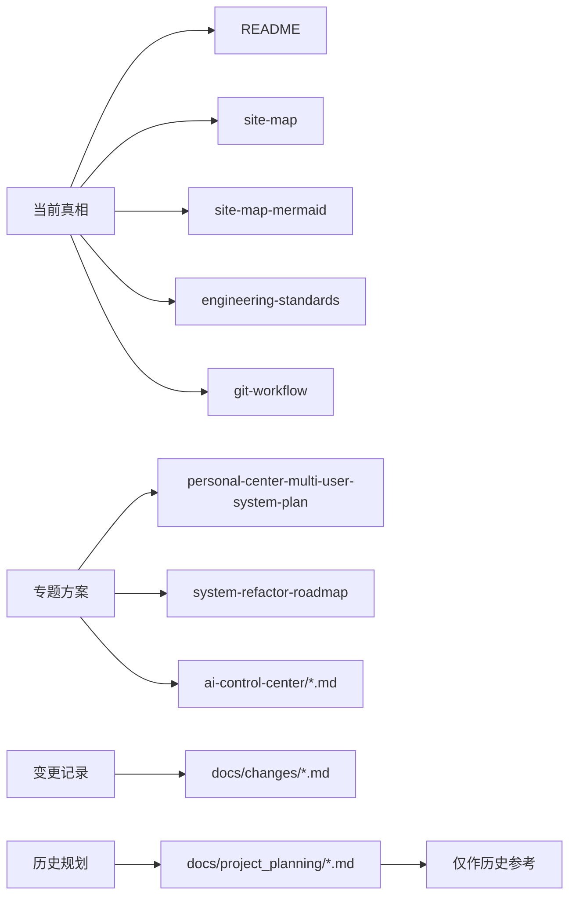

## 全局经营驾驶舱

```mermaid
flowchart LR
  B[授权品牌和自然周期] --> C[全量统计与来源快照]
  C --> P[稳定增长计划需求]
  P --> W[WorkBuddy专业团队接单]
  W --> V[不可变计划版本]
  V --> A[用户确认生效]
  A --> D[计划级只读数据检查]
  D --> Q[偏差待专家队列]
  Q --> W
  W --> R[调整建议与用户决定]
  R --> V
```


## 本机WorkBuddy专业执行

```mermaid
flowchart LR
  Q[授权品牌计划队列] --> H[本机监听器]
  H --> G[限定计划的MCP代理与工具守卫]
  G --> W[WorkBuddy随包执行引擎]
  W --> T[真实专业成员]
  T --> R[成员回传与完整报告]
  R --> S[同源提交与独立读回]
  S --> UI[驾驶舱待审版本]
  H --> HB[已鉴权心跳与在线状态]
  HB --> UI
```


## 2026-10-22 素材发现与复用索引（357）

联查采集原作与素材档案，类型含音频、MIME优先且解码另验；产品/片段/版本/权益按品牌追加不可变索引修订。先筛选后分页，不自动全量入库；深度作品拆解留在内容获客。原MCP查询扩展与manage_brand_library维护共用服务，未知授权不推断。详见[素材索引契约](material-archive-index.md)。


## 2026-10-23 / 358 素材预览修复

创作素材既有节点保留；同一预览组件处理视频、图片、音频、HTML文档与纯文字，HTML内嵌站内资源按当前品牌会话读取。此修复不新增页面节点。 见[变更与验证](changes/2026-10-23-creative-material-preview.md)。


## 2026-10-23 / 359 安装客户端更新

共用安装区六选项改为AI智控中心、WorkBuddy、豆包工作、千问办公、Codex、MCP地址；豆包表单与千问JSON分别展示，旧连接不撤销。客户端模板依据用户截图/官方协议，不能凭模板生成称原生客户端已接通；复制、脱敏、当前品牌与安装包需同源核验。见[变更与验证](changes/2026-10-23-openclaw-client-guides.md)。

## 2026-10-23 日历增量

```mermaid
flowchart LR
 Calendar[三平台营销日历] --> Version[日历版本与修订]
 Calendar --> Day[当天完整内容列表]
 Day --> Content[稳定内容ID]
 Content --> Evidence[商品与素材片段证据]
 Content --> Actual[真实任务与成片引用]
 Actual --> Review[审核与可比指标复盘]
```

## 2026-10-24 巨量广告

```mermaid
flowchart LR
 Paid[投流获客] --> Tencent[腾讯广告原工作区]
 Paid --> Ocean[巨量广告]
 Doubao[豆包只读广告查询] --> MCP[品牌MCP ocean动作]
 MCP --> Scope[账户映射与批次校验]
 Scope --> Snapshot[不可变快照]
 Snapshot --> Diagnosis[诊断与证据]
 Diagnosis --> Plan[本地优化计划与修订]
 Ocean --> Scope
 Ocean --> Diagnosis
 Ocean --> Plan
```


383新增数据关系：

```mermaid
flowchart LR
 B[品牌资料和有赞来源] --> D[不可变增长数据]
 D --> R[明细复算或来源汇总]
 R --> K[经营诊断与人群规则]
 K --> P[战略与策略]
 P --> X[有赞配置与内容交接]
 X --> E[实际执行及客户反馈]
 E --> V[成熟窗口复盘与下一周期]
 V --> P
```


384老板视图：

```mermaid
flowchart LR
 D[同店同日真实数据] --> K[进店 转化 客单 复购 投流]
 K --> P[对应经营计划与目标]
 P --> T[具体动作 负责人 时间]
 T --> E[实际执行与结果]
 E --> R[同口径目标与实际]
 R --> N[继续 调整 停止与下一计划]
 N --> P
 C[内容 投流 商品页 AI销售 会员客户] --> T
```

```mermaid
flowchart LR
 B[品牌生意模式与经营基线] --> F[财务目标与驱动指标]
 F --> T[对应动作 资源 方法 排期]
 T --> E[实际执行回执]
 D[授权连接器回写不可变快照] --> C[完整窗口目标实际检查]
 F --> C
 E --> R[差距原因与具体调整]
 C --> R
 R --> F
```

```mermaid
flowchart LR
  GMV401[GMV情景目标] --> Channel401[渠道贡献与支撑指标]
  Channel401 --> Action401[稳定行动与资源排期]
  Action401 --> Studio401[商品主图 / 详情 / 视频]
  Studio401 --> Task401[品牌受控制作任务]
  Task401 --> Codex401[本机Codex及已授权模型]
  Codex401 --> Version401[MCP产物新版本与回执]
  Version401 --> Review401[同口径结果复盘]
  Review401 --> GMV401
```

## 402 电商执行与修订

```mermaid
flowchart LR
  Strategy[电商策略具体动作] -->|当前品牌及计划版本| Operator[六类店铺运营执行单]
  Operator --> Draft[核条件并保存版本]
  Draft --> Capability{实际写能力}
  Capability -->|当前未接通| Manual[完整执行单交店铺后台]
  Manual --> Receipt[人工上报及改后核对]
  Execution[执行目标跟踪] --> Cadence[每指标日周月自定义窗口]
  Cadence --> Snapshot[同口径已入库报表对照]
  Creative[商品创作] --> Feedback[直接编辑或Codex意见]
  Feedback --> Revision[新版本及旧媒体待更新]
```

参考[402](changes/2026-10-27-commerce-operator-revision.md)。

```mermaid
flowchart LR
 E[编辑GMV 订单 每单金额] --> Q[冻结源版本 Codex重规划]
 Q --> V[校验指标 费用 引用 新版本]
 V --> S[战略阶段与三档目标]
 S --> T[七类策略 对象 参数 步骤 费用]
 T --> C[商品主图 详情 视频项目]
 T --> M[商家按步骤实施并记录回执]
 M --> R[逐指标窗口 目标实际与优化]
 D[有来源的经营快照] --> B[四专题经营看板]
 D --> R
 R --> Q
```


404增量：电商目标按历史复算，独立广告投流/仅计广告费与ROI，逐指标历史/窗口状态，商品四步利益型创作。见[404变更](changes/2026-10-27-commerce-history-and-benefit-copy.md)。
